# Launch batch: 21 real clip coins

Real clips that went viral between 15 and 24 Oct 2026, run through the app's own pipeline (`resolveClip` → `downloadVideo` → `renderClip`).
Nothing is launched yet: this is ready for the platform wallet to send.

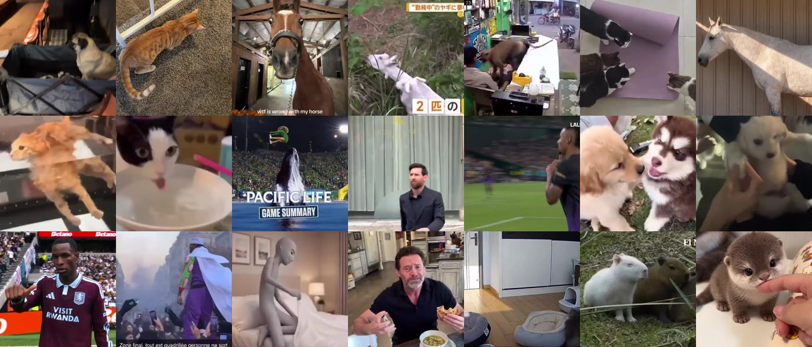

| # | Thumbnail | Source | Name | Ticker | Why it's viral |
|---|---|---|---|---|---|
| 1 | 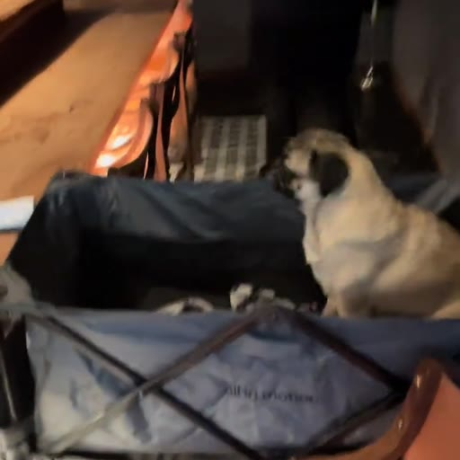 `media/OMAKASE/still.jpg` | [tiktok.com](https://www.tiktok.com/@roodabeguh/video/7699592378243353886) | Omakase Pug | $OMAKASE | TikTok @roodabeguh, TAG24 Viral Video of the Day (23 Oct): pug gets a 17-course omakase for his birthday |
| 2 | 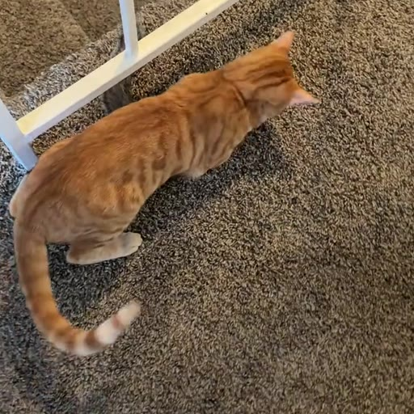 `media/BESTIES/still.jpg` | [tiktok.com](https://www.tiktok.com/@tuvok_nutters/video/7698792136862436621) | Cat Squirrel Besties | $BESTIES | TikTok @tuvok_nutters, TAG24 Viral Video of the Day (22 Oct): cat and squirrel become besties |
| 3 | 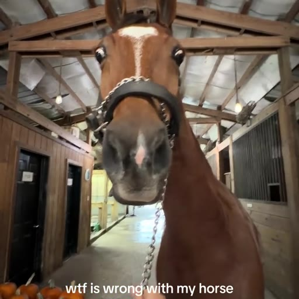 `media/HENRY/still.jpg` | [tiktok.com](https://www.tiktok.com/@ronniesbiologicalmom/video/7694022855893306654) | Henry vs Pumpkins | $HENRY | TikTok @ronniesbiologicalmom, TAG24 Viral Video of the Day (15 Oct): "wtf is wrong with my horse" |
| 4 | 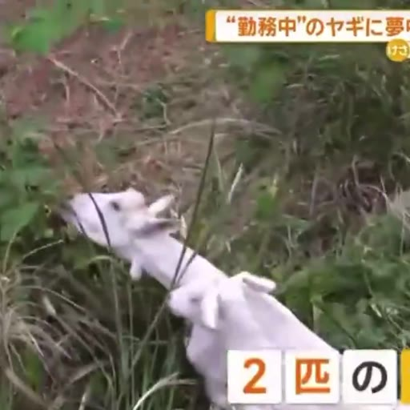 `media/GOATS/still.jpg` | [x.com](https://x.com/fuuuukatsu/status/2112719998838022619) | Station Goats | $GOATS | X @fuuuukatsu, 4.4M views (21 Oct); "JR's official mascots" meme in English |
| 5 | 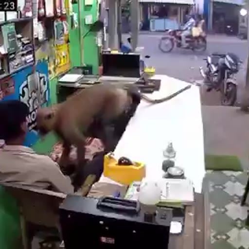 `media/HUG/still.jpg` | [x.com](https://x.com/Marmor_Informa/status/2114005047680139281) | Monkey Hug | $HUG | Shop CCTV, picked up by news accounts on 24 Oct (source post is a news repost, low engagement: weakest pick) |
| 6 | 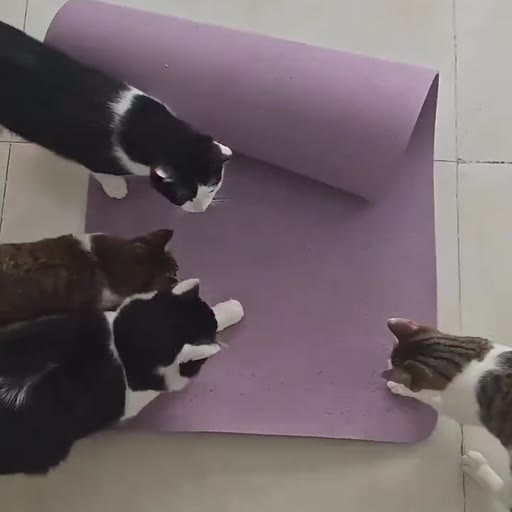 `media/CATS/still.jpg` | [x.com](https://x.com/catgoesviral/status/2111408882207830433) | Cat Gang | $CATS | X @catgoesviral, 140K likes, 3.8M views (17 Oct) |
| 7 | 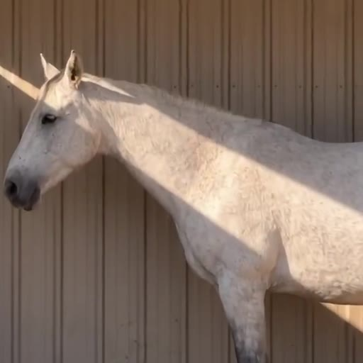 `media/UNICORN/still.jpg` | [x.com](https://x.com/RaminNasibov/status/2112957620772274232) | Unicorns Exist | $UNICORN | X @RaminNasibov "unicorns exist", 84K likes, 1.9M views (21 Oct) |
| 8 | 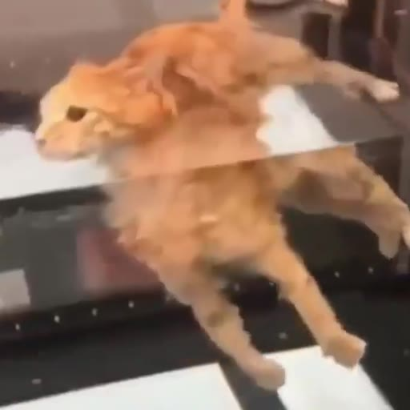 `media/GLASS/still.jpg` | [x.com](https://x.com/PunchingCat/status/2112987369209217131) | Glass Table Cat | $GLASS | X @PunchingCat, 33K likes (21 Oct) |
| 9 |  `media/HYDRATE/still.jpg` | [x.com](https://x.com/sillymeow4u/status/2112203766527385845) | Hydrate | $HYDRATE | X @sillymeow4u "reminder to hydrate", 20K likes (19 Oct) |
| 10 | 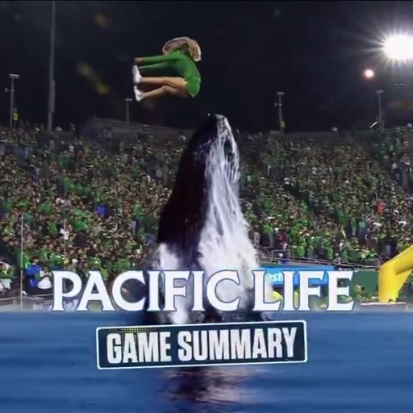 `media/WHALE/still.jpg` | [x.com](https://x.com/carterjlowe/status/2111702183897182439) | Rogue Whale | $WHALE | X @carterjlowe, 77K likes, 2.3M views (18 Oct): Autzen Stadium AR whale vs cheerleader |
| 11 |  `media/MESSI/still.jpg` | [x.com](https://x.com/Messias30_/status/2113262368486781429) | Messi Breaks Protocol | $MESSI | X @Messias30_, 33K likes (22 Oct) |
| 12 | 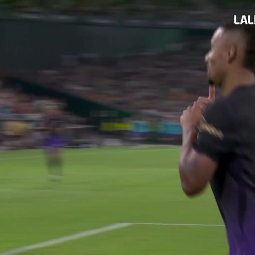 `media/CALLME/still.jpg` | [x.com](https://x.com/FCBarcelona/status/2111521719835877646) | Lamine Calls | $CALLME | X @FCBarcelona, 59K likes, 1M views (17 Oct) |
| 13 | 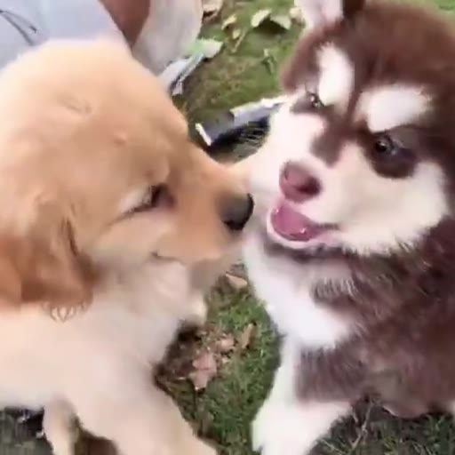 `media/PUPS/still.jpg` | [x.com](https://x.com/cutiespuppies/status/2110561045366415426) | Golden and Husky | $PUPS | X @cutiespuppies, 21K likes, 372K views (15 Oct) |
| 14 | 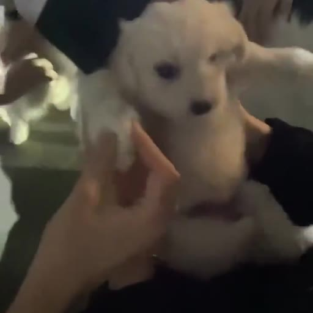 `media/QUIET/still.jpg` | [x.com](https://x.com/obitofemme/status/2112969590774861981) | Quiet Puppy | $QUIET | X @obitofemme, 46K likes (21 Oct) |
| 15 |  `media/COLD/still.jpg` | [x.com](https://x.com/UTDTrey/status/2113976396024606979) | Cold Celebration | $COLD | X @UTDTrey "Cold celebration dawg", 27K likes (24 Oct) |
| 16 |  `media/PICCOLO/still.jpg` | [x.com](https://x.com/vidsthatgohard/status/2111598352395895065) | Piccolo in Paris | $PICCOLO | X @vidsthatgohard, 169K likes (17 Oct): Piccolo cosplayer towering over a Paris crowd |
| 17 |  `media/CANCEL/still.jpg` | [x.com](https://x.com/senshi_real/status/2113457273271959640) | Do You Mind If We Cancel | $CANCEL | X @senshi_real, 138K likes (22 Oct): relief-in-bed reaction meme |
| 18 |  `media/WOLVERINE/still.jpg` | [x.com](https://x.com/ic333_T/status/2110269201063841821) | Wolverine Gets It | $WOLVERINE | X @ic333_T, 109K likes (16 Oct): Hugh Jackman reaction clip |
| 19 | 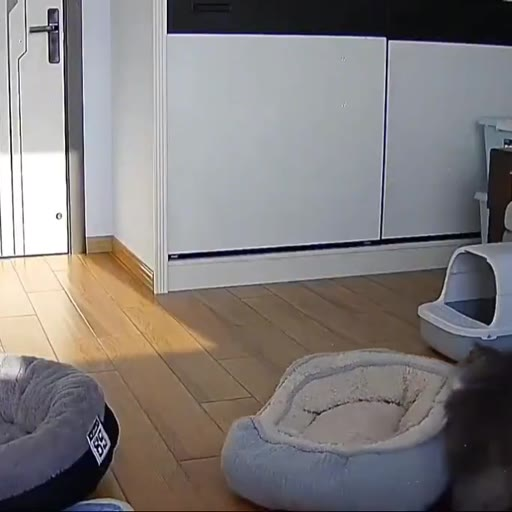 `media/ALONE/still.jpg` | [x.com](https://x.com/Novit_aa/status/2113631934484275244) | Cats Home Alone | $ALONE | X @Novit_aa, 37K likes (23 Oct): pet-cam of cats partying alone |
| 20 | 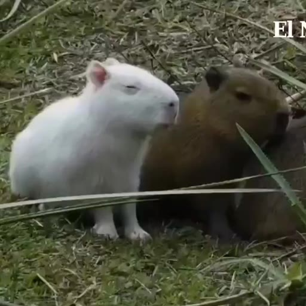 `media/ALBINO/still.jpg` | [x.com](https://x.com/capyfamily_usa/status/2112077446258565135) | Albino Capybara | $ALBINO | X @capyfamily_usa, 43K likes (18 Oct): albino capybara spotted in Uruguay |
| 21 | 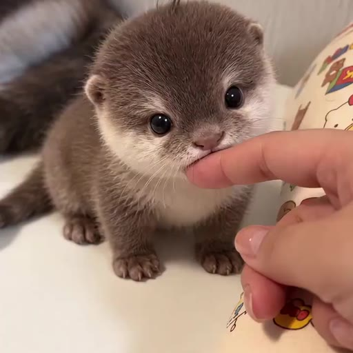 `media/OTTER/still.jpg` | [x.com](https://x.com/lynethiona/status/2110591730651418718) | Baby Otter | $OTTER | X @lynethiona, 17K likes (15 Oct) |

Descriptions, crops and source URLs live in `clips.json`. Media: `media/<TICKER>/still.jpg` (512 px) + `loop.mp4` (360 px, silent, 3 to 4 s).

## Cost (measured on mainnet, `scripts/measure-create.mts`, simulate only)

A sponsored launch is one `create_v2` (Token-2022 mint with its metadata inside the mint, no Metaplex account) and no first buy. The payer funds 3 accounts plus the tx fee:

| | lamports |
|---|---|
| mint (Token-2022 + metadata ext., ~407 B; ~6,960 lamports per byte of name + ticker + URI) | ~2,718,000 |
| bonding curve (166 B) | 1,493,520 |
| bonding curve token account (170 B) | 1,513,840 |
| tx fee (2 signatures: platform + mint) | 10,000 |
| priority fee (140k CU limit × 1,000 µlamports) | 140 |
| **total** | **~5.71M to 5.80M (avg 5.75M = 0.00575 SOL)** |

Before this change: 6,039,160 lamports for the same coin (200,000 µlamports × 250k CU = 50,000 lamports of priority fee, and a 107-char `meta/<uuid>/meta.json` URI).
After: 5,735,280 lamports (-5%). Nothing in the create is closable afterwards: all three accounts belong to pump.fun.

**Batch total (dry run on mainnet): 0.120741 SOL for 21 coins.** With 0.13 SOL in the platform wallet that leaves 0.0093 SOL, above the 0.005 SOL reserve. If pump.fun's IPFS endpoint answers with a longer `bafkrei…` URI it adds ~0.00006 SOL per coin (~0.0012 SOL in all), still above the reserve. The script re-checks the balance before every launch and stops before going under the reserve.

## Commands

```
# 0. (done) media: re-run to retune crops (source videos cached in BATCH_CACHE)
npx tsx --conditions react-server scripts/prepare-batch.mts [TICKER ...]

# 1. dry run (default): builds, signs and simulates every create on mainnet. Sends nothing, uploads nothing, reserves no mint.
npx tsx --conditions react-server scripts/launch-batch.ts --env .env.mainnet

# 2. live
BATCH_FEE_RECIPIENT=<creator fee address> npx tsx --conditions react-server scripts/launch-batch.ts --env .env.mainnet --go
```

`--go` uploads media to Vercel Blob (`BLOB_READ_WRITE_TOKEN`, read from `.env.local` if not in the env file), takes vanity mints from the Neon pool (60 free), writes `mint` and `sig` back into `clips.json` (a rerun skips launched coins) and records each coin in the `coins` table so the home page shows it. It stops at the first failure. `BATCH_FEE_RECIPIENT` defaults to the platform wallet. `--only T1,T2` and `--limit N` narrow the run.
